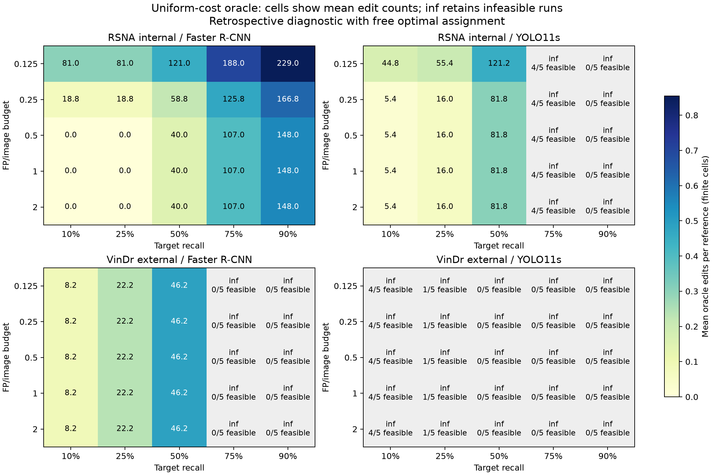
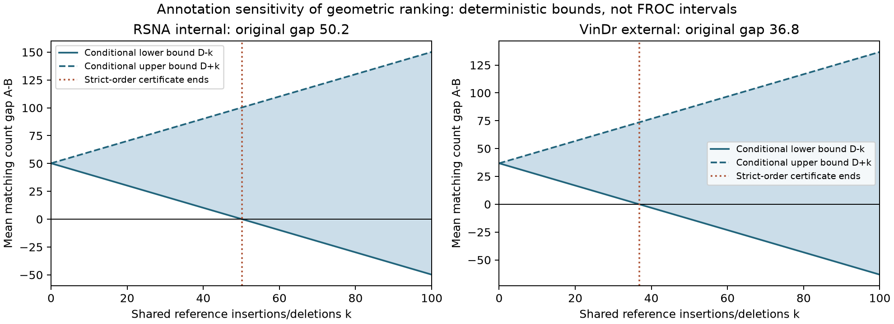

# Constrained repairability v1: exploratory results

Generated from the separately hash-bound saved-output analysis. All costs are
retrospective annotation-informed membership oracles, with free optimal
assignment. They are not achieved performance or clinical correction effort.

All 5 seeds per detector, both full cohorts, all 5 original budgets and all 5 target levels are included: 500 exact flow/formula comparisons.
Infeasible run/grid cells: 180.
All 220 imposed output controls passed.

## Target costs at the original presentation budget

Budget 0.25 FP/image. Unit cost counts promotions plus suppressions.
The mean is infinite if any retained run is infeasible. Fractions are over
the five observed runs. Brackets are marginal 95% joint observation/run
bootstrap percentile intervals (2,000 draws; inverse empirical CDF).
Infinity remains in the resampling distribution. It is not replaced by a finite average.

| Cohort | Detector | Target recall | Feasible runs | Mean edits [95% interval] | Edits/reference | Edits/image | Infinite cost draws |
|---|---|---:|---:|---|---:|---:|---:|
| internal | faster_rcnn | 10% | 5/5 | 18.8 [0.0, 67.2] | 0.070 | 0.0251 | 0 |
| internal | faster_rcnn | 25% | 5/5 | 18.8 [0.0, 67.2] | 0.070 | 0.0251 | 0 |
| internal | faster_rcnn | 50% | 5/5 | 58.8 [29.8, 107.0] | 0.219 | 0.0784 | 0 |
| internal | faster_rcnn | 75% | 5/5 | 125.8 [80.0, 196.6] | 0.469 | 0.1677 | 0 |
| internal | faster_rcnn | 90% | 5/5 | 166.8 [108.4, 249.0] | 0.622 | 0.2224 | 0 |
| internal | yolo11s | 10% | 5/5 | 5.4 [0.0, 23.2] | 0.020 | 0.0072 | 0 |
| internal | yolo11s | 25% | 5/5 | 16.0 [0.0, 48.8] | 0.060 | 0.0213 | 0 |
| internal | yolo11s | 50% | 5/5 | 81.8 [53.8, infinity] | 0.305 | 0.1091 | 90 |
| internal | yolo11s | 75% | 4/5 | infinity [116.2, infinity] | infinity | infinity | 1347 |
| internal | yolo11s | 90% | 0/5 | infinity [infinity, infinity] | infinity | infinity | 2000 |
| external | faster_rcnn | 10% | 5/5 | 8.2 [5.0, 10.8] | 0.086 | 0.0027 | 0 |
| external | faster_rcnn | 25% | 5/5 | 22.2 [17.2, 27.8] | 0.234 | 0.0074 | 0 |
| external | faster_rcnn | 50% | 5/5 | 46.2 [36.8, infinity] | 0.486 | 0.0154 | 630 |
| external | faster_rcnn | 75% | 0/5 | infinity [infinity, infinity] | infinity | infinity | 2000 |
| external | faster_rcnn | 90% | 0/5 | infinity [infinity, infinity] | infinity | infinity | 2000 |
| external | yolo11s | 10% | 4/5 | infinity [7.6, infinity] | infinity | infinity | 825 |
| external | yolo11s | 25% | 1/5 | infinity [infinity, infinity] | infinity | infinity | 1993 |
| external | yolo11s | 50% | 0/5 | infinity [infinity, infinity] | infinity | infinity | 2000 |
| external | yolo11s | 75% | 0/5 | infinity [infinity, infinity] | infinity | infinity | 2000 |
| external | yolo11s | 90% | 0/5 | infinity [infinity, infinity] | infinity | infinity | 2000 |

No undefined draws occurred in this real-data run; zero-reference synthetic
draws remain explicitly undefined. Every budget and normalized interval is in
[intervals.csv](../results/constrained_repairability_v1/intervals.csv).

## Counts and existing diagnostics

Equal-run means. H is the historical selected count; r is its maximum
matching count; M is full retained maximum matching. The new analysis
checked that r equals historical greedy TP in every baseline run.

| Cohort | Detector | H | r | M | Reference boxes | FROC ceiling at 0.25 | Geometric coverage |
|---|---|---:|---:|---:|---:|---:|---:|
| internal | faster_rcnn | 268.0 | 94.0 | 260.8 | 268 | 0.366418 | 0.973134 |
| internal | yolo11s | 166.0 | 52.2 | 210.6 | 268 | 0.266418 | 0.785821 |
| external | faster_rcnn | 144.8 | 1.8 | 54.0 | 95 | 0.086316 | 0.568421 |
| external | yolo11s | 81.6 | 0.4 | 17.2 | 95 | 0.033684 | 0.181053 |

All external historical FP counts already fit the smallest original budget.
Consequently, all feasible external unit-cost optima require zero suppression
and depend only on K-r; increasing the FP budget leaves these costs unchanged.
This demonstrates the gap between ideal reference-informed promotions and a
real score-prefix policy; it does not demonstrate successful repair.

## Conditional annotation-edit sensitivity

| Cohort | Mean geometric count gap A-B | Largest integer k certifying strict A>B | k/original references |
|---|---:|---:|---:|
| internal | 50.2 | 50 | 0.187 |
| external | 36.8 | 36 | 0.379 |

A=Faster R-CNN; B=YOLO11s. The theorem concerns shared reference insertions/
deletions with fixed candidates; relocation counts as two. It does not bound
FROC, estimate label error, establish clinical equivalence, or show the bound
can actually be attained. Curves are deterministic, not confidence bands.

## OC-cost diagnostic comparison

Independent equation-based implementation, lambda=0.5 and beta=0.6, with
the authors' dummy transport convention and zero cost for empty/empty images.
Equal image weighting then equal run weighting; descriptive means, no CIs.
No postprocessing parameter was optimized for this comparison.

| Cohort | Detector | Historical selections | All retained candidates |
|---|---|---:|---:|
| internal | faster_rcnn | 0.146773 | 0.598524 |
| internal | yolo11s | 0.148507 | 0.532369 |
| external | faster_rcnn | 0.039319 | 0.599920 |
| external | yolo11s | 0.028291 | 0.518704 |

Lower OC-cost is better under its own objective. The low external historical
values coexist with severe missed-object failure because empty/empty images
contribute zero and images are weighted equally. The large full-retained
values reflect dense extra predictions. These different estimands should not
be ranked as competing clinical performance measures.

## Interpretation

The exact formula is C*=p*(K-r)+ + q*(H-r-B)+ whenever K<=M, infinity otherwise.
Here x+ means max(0,x). Every grid cell agrees with integral minimum-cost flow.
Thus unit costs re-express H,r,M rather than supply an independent diagnostic.
See the [research assessment](CONSTRAINED_REPAIRABILITY_RESEARCH_ASSESSMENT.md)
for full proofs, assumptions, counterexamples, prior work and the NO-GO verdict.
