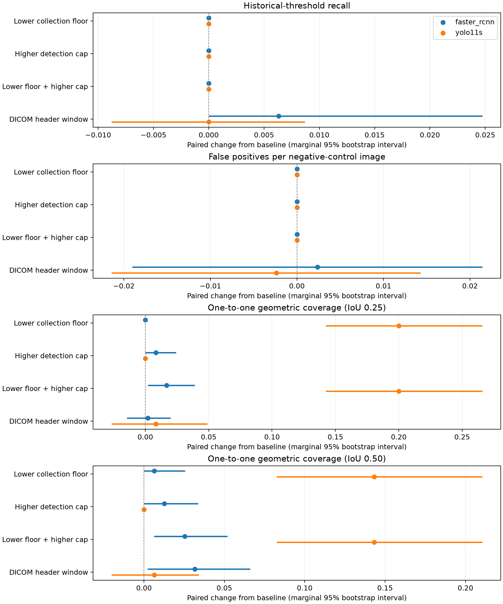

# External failure isolation v1: executed diagnostic results

Exploratory controlled diagnostic, designed after the original outcomes were known.
See [protocol](EXTERNAL_FAILURE_ISOLATION_V1.md) for the frozen interventions and limits.

Cohort: 84 strict-positive images, 95 boxes, 84 randomly selected strict negatives; five retained checkpoints per detector. Original predictions and nested baseline retention were replayed exactly for every image/run.

These paired effects concern the tested implementation controls. They do not identify the causes of the total cross-dataset gap or validate new operating rules.

Summary SHA-256: `2cced016913cf2c75e89f77cf435ac18c9b358b228679340f8ddbaf2d827945a`.

## Full-cohort evaluation-floor control

All 3,000 external images, unchanged saved predictions and COCO maxDets 100. AP50 uses either the original evaluation floor 0.001 or 0.00001. Equal-run means:

| Detector | Original AP50 | Lower evaluation floor AP50 | Change |
|---|---:|---:|---:|
| faster_rcnn | 0.002505098 | 0.002697961 | 0.000192863 |
| yolo11s | 0.000500694 | 0.000887913 | 0.000387220 |

## Historical-threshold recall

| Detector | Arm | Mean | Change from baseline | 95% interval for change |
|---|---|---:|---:|---|
| faster_rcnn | baseline | 0.018947 | 0.000000 | [0.000000, 0.000000] |
| faster_rcnn | lower_floor | 0.018947 | 0.000000 | [0.000000, 0.000000] |
| faster_rcnn | higher_cap | 0.018947 | 0.000000 | [0.000000, 0.000000] |
| faster_rcnn | expanded | 0.018947 | 0.000000 | [0.000000, 0.000000] |
| faster_rcnn | dicom_window | 0.025263 | 0.006316 | [0.000000, 0.024742] |
| faster_rcnn | floor_cap_interaction | n/a | 0.000000 | [0.000000, 0.000000] |
| yolo11s | baseline | 0.004211 | 0.000000 | [0.000000, 0.000000] |
| yolo11s | lower_floor | 0.004211 | 0.000000 | [0.000000, 0.000000] |
| yolo11s | higher_cap | 0.004211 | 0.000000 | [0.000000, 0.000000] |
| yolo11s | expanded | 0.004211 | 0.000000 | [0.000000, 0.000000] |
| yolo11s | dicom_window | 0.004211 | 0.000000 | [-0.008791, 0.008696] |
| yolo11s | floor_cap_interaction | n/a | 0.000000 | [0.000000, 0.000000] |

## False positives per negative-control image

| Detector | Arm | Mean | Change from baseline | 95% interval for change |
|---|---|---:|---:|---|
| faster_rcnn | baseline | 0.045238 | 0.000000 | [0.000000, 0.000000] |
| faster_rcnn | lower_floor | 0.045238 | 0.000000 | [0.000000, 0.000000] |
| faster_rcnn | higher_cap | 0.045238 | 0.000000 | [0.000000, 0.000000] |
| faster_rcnn | expanded | 0.045238 | 0.000000 | [0.000000, 0.000000] |
| faster_rcnn | dicom_window | 0.047619 | 0.002381 | [-0.019048, 0.021429] |
| faster_rcnn | floor_cap_interaction | n/a | 0.000000 | [0.000000, 0.000000] |
| yolo11s | baseline | 0.030952 | 0.000000 | [0.000000, 0.000000] |
| yolo11s | lower_floor | 0.030952 | 0.000000 | [0.000000, 0.000000] |
| yolo11s | higher_cap | 0.030952 | 0.000000 | [0.000000, 0.000000] |
| yolo11s | expanded | 0.030952 | 0.000000 | [0.000000, 0.000000] |
| yolo11s | dicom_window | 0.028571 | -0.002381 | [-0.021429, 0.014286] |
| yolo11s | floor_cap_interaction | n/a | 0.000000 | [0.000000, 0.000000] |

## One-to-one geometric coverage (IoU 0.25)

| Detector | Arm | Mean | Change from baseline | 95% interval for change |
|---|---|---:|---:|---|
| faster_rcnn | baseline | 0.818947 | 0.000000 | [0.000000, 0.000000] |
| faster_rcnn | lower_floor | 0.818947 | 0.000000 | [0.000000, 0.000000] |
| faster_rcnn | higher_cap | 0.827368 | 0.008421 | [0.000000, 0.024176] |
| faster_rcnn | expanded | 0.835789 | 0.016842 | [0.002000, 0.039132] |
| faster_rcnn | dicom_window | 0.821053 | 0.002105 | [-0.014583, 0.019780] |
| faster_rcnn | floor_cap_interaction | n/a | 0.008421 | [0.000000, 0.028571] |
| yolo11s | baseline | 0.397895 | 0.000000 | [0.000000, 0.000000] |
| yolo11s | lower_floor | 0.597895 | 0.200000 | [0.142538, 0.265958] |
| yolo11s | higher_cap | 0.397895 | 0.000000 | [0.000000, 0.000000] |
| yolo11s | expanded | 0.597895 | 0.200000 | [0.142538, 0.265958] |
| yolo11s | dicom_window | 0.406316 | 0.008421 | [-0.026670, 0.048937] |
| yolo11s | floor_cap_interaction | n/a | 0.000000 | [0.000000, 0.000000] |

## One-to-one geometric coverage (IoU 0.50)

| Detector | Arm | Mean | Change from baseline | 95% interval for change |
|---|---|---:|---:|---|
| faster_rcnn | baseline | 0.568421 | 0.000000 | [0.000000, 0.000000] |
| faster_rcnn | lower_floor | 0.574737 | 0.006316 | [0.000000, 0.025539] |
| faster_rcnn | higher_cap | 0.581053 | 0.012632 | [0.000000, 0.033684] |
| faster_rcnn | expanded | 0.593684 | 0.025263 | [0.006186, 0.052002] |
| faster_rcnn | dicom_window | 0.600000 | 0.031579 | [0.002149, 0.065997] |
| faster_rcnn | floor_cap_interaction | n/a | 0.006316 | [-0.000000, 0.021573] |
| yolo11s | baseline | 0.181053 | 0.000000 | [0.000000, 0.000000] |
| yolo11s | lower_floor | 0.324211 | 0.143158 | [0.082605, 0.210538] |
| yolo11s | higher_cap | 0.181053 | 0.000000 | [0.000000, 0.000000] |
| yolo11s | expanded | 0.324211 | 0.143158 | [0.082605, 0.210538] |
| yolo11s | dicom_window | 0.187368 | 0.006316 | [-0.020229, 0.034043] |
| yolo11s | floor_cap_interaction | n/a | 0.000000 | [0.000000, 0.000000] |

## Limits

Intervals are marginal and conditional on this diagnostic cohort and the five trained checkpoints. Zero-containing intervals do not establish equivalence. Geometric coverage is an annotation-informed one-to-one upper bound; it is not achieved recall or clinical correctness. Negative-control FP/image is conditional on the fixed negative sample. Clinical label equivalence, upstream proposals and population/acquisition causes remain unresolved.

