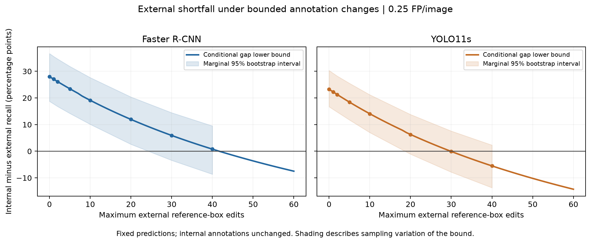
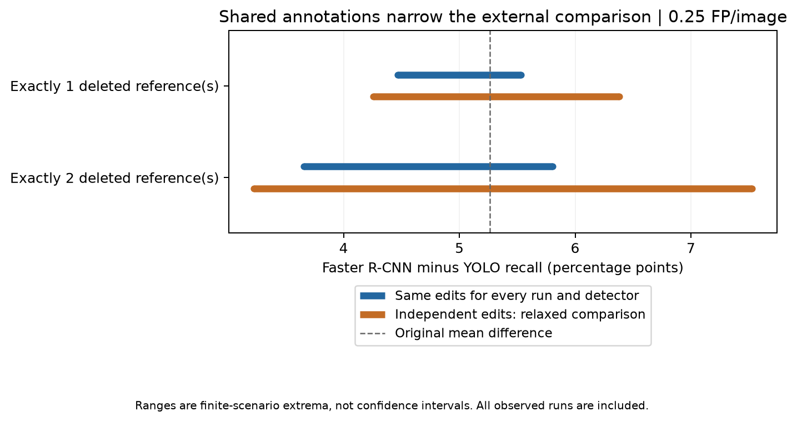

# Shared-annotation FROC audit: results v1

Generated from hash-verified public aggregates. This is a retrospective sensitivity analysis, not clinical relabeling or a deployed repair.

See the [method and proofs](FROC_ANNOTATION_METHOD_V1.md) and [protocol](FROC_ANNOTATION_PROTOCOL_V1.md).

All five seeds per detector, both complete cohorts and all five original budgets were analyzed. The primary display uses **0.25 FP/image**.

## Conditional domain-gap certificates

Only external references may change here; internal annotations, images and all detector candidates remain fixed. The maximum tested count is not an estimated error rate.

| Detector | Internal recall | External recall | Largest tested edit budget with positive gap lower bound |
|---|---:|---:|---:|
| Faster R-CNN | 0.366418 | 0.086316 | 41 |
| YOLO11s | 0.266418 | 0.033684 | 29 |

The next edit count loses the conservative certificate; it does not demonstrate an attainable explanation or recovery. Sampling uncertainty is more restrictive than these point certificates.

| Detector | External edit budget | Gap lower bound | Marginal 95% interval for that bound |
|---|---:|---:|---|
| Faster R-CNN | 0 | 0.280102 | [0.187319, 0.366683] |
| Faster R-CNN | 10 | 0.191180 | [0.101008, 0.276456] |
| Faster R-CNN | 20 | 0.119461 | [0.025995, 0.203687] |
| Faster R-CNN | 30 | 0.059218 | [-0.034156, 0.144612] |
| Faster R-CNN | 40 | 0.007899 | [-0.086315, 0.095064] |
| YOLO11s | 0 | 0.232734 | [0.167052, 0.303170] |
| YOLO11s | 10 | 0.140704 | [0.070139, 0.211927] |
| YOLO11s | 20 | 0.062940 | [-0.010915, 0.137915] |
| YOLO11s | 30 | -0.000782 | [-0.078415, 0.075810] |
| YOLO11s | 40 | -0.055064 | [-0.136834, 0.023058] |

Intervals use 2,000 joint patient/image/run draws. The edit units are resampled observation copies. These are marginal percentile intervals for conditional bound endpoints, not finite-sample or clinical-error guarantees.

## Exact shared-reference deletion census

Every subset of one/two existing references was evaluated: 268/35,778 internal subsets and 95/4,465 external subsets. Each subset is shared across both detectors and every seed before averaging and comparing.

| External deletions | Shared difference range | Independent-edit range | Width reduction |
|---:|---|---|---:|
| 1 | [0.044681, 0.055319] | [0.042553, 0.063830] | 50.0% |
| 2 | [0.036559, 0.058065] | [0.032258, 0.075269] | 50.0% |

These are exact extrema for the declared finite deletion set, not confidence intervals. Independent edits can require contradictory annotation sets across runs/detectors; that relaxation is shown only as a comparator. No annotation is asserted incorrect, and no corrected labels are exported.

## Interpretation and limits

The exact shared-subset result adds information absent from complete marginal FROC curves; the method includes a constructive proof. It also distinguishes annotation sensitivity from sampling uncertainty. It does not identify clinical causes, prove label equivalence or establish publication priority. Bounds are conditional on fixed scores, geometry, caps, image population and the canonical one-to-one matcher; crowd/ignore protocols are outside scope.

Full values for every original budget are in the public `envelopes.csv`, `exact_deletions.csv`, `intervals.csv` and `contrasts.csv` beside the figures. Observation-linked arrays remain private.
