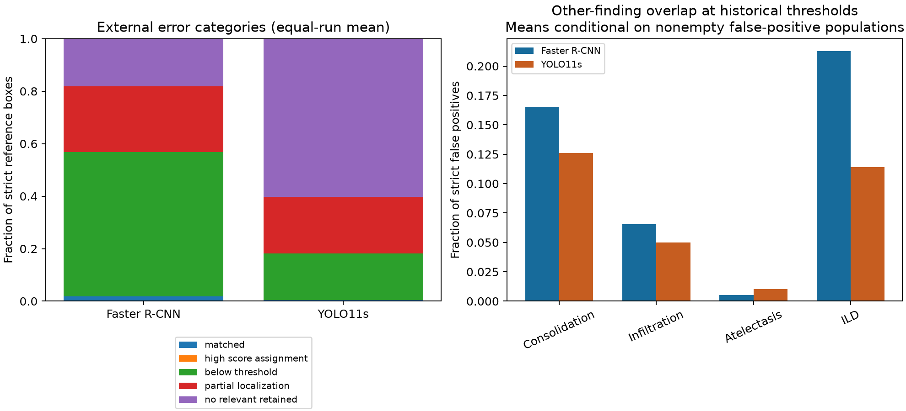
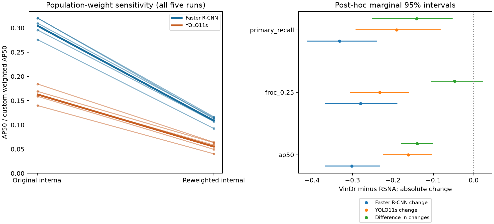

# Post-hoc external generalization results v1

Generated from executed frozen-prediction analysis. Findings are EXPLORATORY; read-only verification and full replay are separate checks. Protocol: [version 1](POSTHOC_EXTERNAL_GENERALIZATION_PROTOCOL.md). No original result, target, threshold or prediction was changed.

## Reference-box error decomposition

Each category is exclusive with protocol-defined precedence. Means/SDs weight runs equally; availability does not imply successful one-to-one assignment. Missing retained output is not proof of absent pre-NMS/proposal output.

| detector | category | quantity | mean | sd | defined_runs | attempted_runs |
| --- | --- | --- | --- | --- | --- | --- |
| faster_rcnn | below_threshold | count | 52.200000 | 3.962323 | 5 | 5 |
| faster_rcnn | below_threshold | fraction | 0.549474 | 0.041709 | 5 | 5 |
| faster_rcnn | high_score_assignment | count | 0.000000 | 0.000000 | 5 | 5 |
| faster_rcnn | high_score_assignment | fraction | 0.000000 | 0.000000 | 5 | 5 |
| faster_rcnn | matched | count | 1.800000 | 1.303840 | 5 | 5 |
| faster_rcnn | matched | fraction | 0.018947 | 0.013725 | 5 | 5 |
| faster_rcnn | no_relevant_retained | count | 17.200000 | 1.095445 | 5 | 5 |
| faster_rcnn | no_relevant_retained | fraction | 0.181053 | 0.011531 | 5 | 5 |
| faster_rcnn | partial_localization | count | 23.800000 | 4.024922 | 5 | 5 |
| faster_rcnn | partial_localization | fraction | 0.250526 | 0.042368 | 5 | 5 |
| yolo11s | below_threshold | count | 16.800000 | 5.495453 | 5 | 5 |
| yolo11s | below_threshold | fraction | 0.176842 | 0.057847 | 5 | 5 |
| yolo11s | high_score_assignment | count | 0.000000 | 0.000000 | 5 | 5 |
| yolo11s | high_score_assignment | fraction | 0.000000 | 0.000000 | 5 | 5 |
| yolo11s | matched | count | 0.400000 | 0.547723 | 5 | 5 |
| yolo11s | matched | fraction | 0.004211 | 0.005766 | 5 | 5 |
| yolo11s | no_relevant_retained | count | 57.200000 | 11.713240 | 5 | 5 |
| yolo11s | no_relevant_retained | fraction | 0.602105 | 0.123297 | 5 | 5 |
| yolo11s | partial_localization | count | 20.600000 | 7.092249 | 5 | 5 |
| yolo11s | partial_localization | fraction | 0.216842 | 0.074655 | 5 | 5 |

## Candidate availability (assignment ignored)

| detector | iou | quantity | mean | sd |
| --- | --- | --- | --- | --- |
| faster_rcnn | 0.250000 | count | 77.800000 | 1.095445 |
| faster_rcnn | 0.250000 | fraction | 0.818947 | 0.011531 |
| faster_rcnn | 0.500000 | count | 54.000000 | 3.391165 |
| faster_rcnn | 0.500000 | fraction | 0.568421 | 0.035696 |
| faster_rcnn | 0.750000 | count | 9.200000 | 3.346640 |
| faster_rcnn | 0.750000 | fraction | 0.096842 | 0.035228 |
| yolo11s | 0.250000 | count | 37.800000 | 11.713240 |
| yolo11s | 0.250000 | fraction | 0.397895 | 0.123297 |
| yolo11s | 0.500000 | count | 17.200000 | 5.630275 |
| yolo11s | 0.500000 | fraction | 0.181053 | 0.059266 |
| yolo11s | 0.750000 | count | 1.600000 | 0.894427 |
| yolo11s | 0.750000 | fraction | 0.016842 | 0.009415 |

## Strict false positives and non-target findings

FP overlap never reclassifies detections as true positives. Fractions use each run's strict FPs; undefined zero-FP runs are counted explicitly. Overlapping class flags need not sum to one. A broader Lung Opacity/Consolidation/Infiltration target remains UNRESOLVED pending expert instance/ontology review; no alternative-task AP is reported.

| detector | support | category | quantity | mean | sd | defined_runs | attempted_runs |
| --- | --- | --- | --- | --- | --- | --- | --- |
| faster_rcnn | historical | ambiguous_partial | count | 34.800000 | 13.791302 | 5 | 5 |
| faster_rcnn | historical | ambiguous_partial | fraction | 0.258654 | 0.046428 | 5 | 5 |
| faster_rcnn | historical | claimed_strict_target | count | 0.000000 | 0.000000 | 5 | 5 |
| faster_rcnn | historical | claimed_strict_target | fraction | 0.000000 | 0.000000 | 5 | 5 |
| faster_rcnn | historical | no_local_overlap | count | 35.600000 | 39.157375 | 5 | 5 |
| faster_rcnn | historical | no_local_overlap | fraction | 0.204786 | 0.129860 | 5 | 5 |
| faster_rcnn | historical | other_local_finding | count | 72.600000 | 27.061042 | 5 | 5 |
| faster_rcnn | historical | other_local_finding | fraction | 0.536561 | 0.099070 | 5 | 5 |
| faster_rcnn | retained | ambiguous_partial | count | 9652.600000 | 442.988487 | 5 | 5 |
| faster_rcnn | retained | ambiguous_partial | fraction | 0.033496 | 0.002085 | 5 | 5 |
| faster_rcnn | retained | claimed_strict_target | count | 44.600000 | 4.722288 | 5 | 5 |
| faster_rcnn | retained | claimed_strict_target | fraction | 0.000155 | 0.000024 | 5 | 5 |
| faster_rcnn | retained | no_local_overlap | count | 277708.400000 | 22466.522613 | 5 | 5 |
| faster_rcnn | retained | no_local_overlap | fraction | 0.960329 | 0.002453 | 5 | 5 |
| faster_rcnn | retained | other_local_finding | count | 1734.800000 | 101.910255 | 5 | 5 |
| faster_rcnn | retained | other_local_finding | fraction | 0.006020 | 0.000423 | 5 | 5 |
| yolo11s | historical | ambiguous_partial | count | 18.400000 | 15.469324 | 5 | 5 |
| yolo11s | historical | ambiguous_partial | fraction | 0.226420 | 0.116507 | 4 | 5 |
| yolo11s | historical | claimed_strict_target | count | 0.000000 | 0.000000 | 5 | 5 |
| yolo11s | historical | claimed_strict_target | fraction | 0.000000 | 0.000000 | 4 | 5 |
| yolo11s | historical | no_local_overlap | count | 33.200000 | 30.605555 | 5 | 5 |
| yolo11s | historical | no_local_overlap | fraction | 0.395630 | 0.193596 | 4 | 5 |
| yolo11s | historical | other_local_finding | count | 29.600000 | 17.742604 | 5 | 5 |
| yolo11s | historical | other_local_finding | fraction | 0.377949 | 0.099408 | 4 | 5 |
| yolo11s | retained | ambiguous_partial | count | 1718.400000 | 1025.667246 | 5 | 5 |
| yolo11s | retained | ambiguous_partial | fraction | 0.103852 | 0.030956 | 5 | 5 |
| yolo11s | retained | claimed_strict_target | count | 4.200000 | 4.086563 | 5 | 5 |
| yolo11s | retained | claimed_strict_target | fraction | 0.000174 | 0.000118 | 5 | 5 |
| yolo11s | retained | no_local_overlap | count | 17813.400000 | 14902.917526 | 5 | 5 |
| yolo11s | retained | no_local_overlap | fraction | 0.860636 | 0.054272 | 5 | 5 |
| yolo11s | retained | other_local_finding | count | 463.400000 | 191.990364 | 5 | 5 |
| yolo11s | retained | other_local_finding | fraction | 0.035338 | 0.023676 | 5 | 5 |

| detector | support | class_name | mean | sd | defined_runs | attempted_runs |
| --- | --- | --- | --- | --- | --- | --- |
| faster_rcnn | historical | Atelectasis | 0.005104 | 0.006314 | 5 | 5 |
| faster_rcnn | historical | Consolidation | 0.165365 | 0.052655 | 5 | 5 |
| faster_rcnn | historical | ILD | 0.212682 | 0.044039 | 5 | 5 |
| faster_rcnn | historical | Infiltration | 0.065645 | 0.014067 | 5 | 5 |
| faster_rcnn | retained | Atelectasis | 0.000246 | 0.000013 | 5 | 5 |
| faster_rcnn | retained | Consolidation | 0.000821 | 0.000095 | 5 | 5 |
| faster_rcnn | retained | ILD | 0.001731 | 0.000196 | 5 | 5 |
| faster_rcnn | retained | Infiltration | 0.000429 | 0.000024 | 5 | 5 |
| yolo11s | historical | Atelectasis | 0.010268 | 0.002331 | 4 | 5 |
| yolo11s | historical | Consolidation | 0.125960 | 0.012793 | 4 | 5 |
| yolo11s | historical | ILD | 0.113853 | 0.033854 | 4 | 5 |
| yolo11s | historical | Infiltration | 0.050054 | 0.024897 | 4 | 5 |
| yolo11s | retained | Atelectasis | 0.001143 | 0.000588 | 5 | 5 |
| yolo11s | retained | Consolidation | 0.010095 | 0.010260 | 5 | 5 |
| yolo11s | retained | ILD | 0.012528 | 0.007080 | 5 | 5 |
| yolo11s | retained | Infiltration | 0.003240 | 0.002029 | 5 | 5 |

## Prevalence standardization

Weighted AP is a custom interpolated detection metric, not official COCO AP. Positive/negative image weights change the evaluation population while fixing internal conditional case mix. This is not a causal prevalence effect or a recreation of VinDr. Recall stays unchanged by construction. ESS describes image-weight concentration, not independent patients. Intervals condition on observed external positive frequency; patient/run resampling re-estimates internal frequency. Integer bootstrap multiplicities weight detection events in the custom metric; they do not use the distinct-copy COCO tie convention. Unit-weight observed AP is reconciled against canonical COCO for every run.

| detector | seed | original_ap50 | standardized_custom_ap50 | original_precision | standardized_precision | original_recall | standardized_recall | image_weight_ess |
| --- | --- | --- | --- | --- | --- | --- | --- | --- |
| faster_rcnn | 17 | 0.295573 | 0.106952 | 0.295455 | 0.061562 | 0.388060 | 0.388060 | 613.206015 |
| faster_rcnn | 42 | 0.309548 | 0.114728 | 0.329268 | 0.069401 | 0.402985 | 0.402985 | 613.206015 |
| faster_rcnn | 137 | 0.320081 | 0.116465 | 0.438202 | 0.121499 | 0.291045 | 0.291045 | 613.206015 |
| faster_rcnn | 271 | 0.320264 | 0.112737 | 0.405172 | 0.098873 | 0.350746 | 0.350746 | 613.206015 |
| faster_rcnn | 314 | 0.275653 | 0.092538 | 0.344000 | 0.081859 | 0.320896 | 0.320896 | 613.206015 |
| yolo11s | 17 | 0.184172 | 0.064016 | 0.294118 | 0.071138 | 0.261194 | 0.261194 | 613.206015 |
| yolo11s | 42 | 0.168934 | 0.063312 | 0.318182 | 0.083469 | 0.261194 | 0.261194 | 613.206015 |
| yolo11s | 137 | 0.139692 | 0.040249 | 0.316384 | 0.069588 | 0.208955 | 0.208955 | 613.206015 |
| yolo11s | 271 | 0.158722 | 0.049452 | 0.000000 | 0.000000 | 0.000000 | 0.000000 | 613.206015 |
| yolo11s | 314 | 0.161540 | 0.058332 | 0.333333 | 0.086672 | 0.242537 | 0.242537 | 613.206015 |

| mode | metric | a_estimate | a_ci_low | a_ci_high | b_estimate | b_ci_low | b_ci_high | a_valid | a_undefined | b_valid | b_undefined |
| --- | --- | --- | --- | --- | --- | --- | --- | --- | --- | --- | --- |
| original | custom_weighted_ap50 | 0.304224 | 0.235233 | 0.369937 | 0.162612 | 0.103678 | 0.224758 | 2000 | 0 | 2000 | 0 |
| original | historical_precision | 0.362419 | 0.284229 | 0.437709 | 0.252403 | 0.117017 | 0.364742 | 2000 | 0 | 2000 | 0 |
| standardized | custom_weighted_ap50 | 0.108684 | 0.074352 | 0.177468 | 0.055072 | 0.032245 | 0.092391 | 2000 | 0 | 2000 | 0 |
| standardized | historical_precision | 0.086639 | 0.060540 | 0.123463 | 0.062173 | 0.027869 | 0.099919 | 2000 | 0 | 2000 | 0 |
| change | custom_weighted_ap50 | -0.195540 | -0.240784 | -0.133194 | -0.107540 | -0.142653 | -0.067420 | 2000 | 0 | 2000 | 0 |
| change | historical_precision | -0.275781 | -0.328438 | -0.215378 | -0.190230 | -0.273524 | -0.087650 | 2000 | 0 | 2000 | 0 |

## Cross-domain changes with shared checkpoint resampling

A = Faster R-CNN; B = YOLO11s. Each change is external minus internal; the difference is change(A) minus change(B). Observations are paired within domain, independently drawn between domains; trained runs are independent between detector families and identical across domains within a family. All intervals are marginal and conditional on the fixed training data/recipe and retained support. Unknown repeated VinDr patients remain unresolved.

| metric | a_estimate | a_ci_low | a_ci_high | b_estimate | b_ci_low | b_ci_high | difference_estimate | difference_ci_low | difference_ci_high | a_valid | a_undefined | b_valid | b_undefined | difference_valid | difference_undefined |
| --- | --- | --- | --- | --- | --- | --- | --- | --- | --- | --- | --- | --- | --- | --- | --- |
| ap50 | -0.301719 | -0.366983 | -0.232342 | -0.162111 | -0.224218 | -0.103034 | -0.139607 | -0.179174 | -0.101154 | 2000 | 0 | 2000 | 0 | 2000 | 0 |
| froc_0.25 | -0.280102 | -0.367012 | -0.188567 | -0.232734 | -0.305797 | -0.159547 | -0.047368 | -0.105416 | 0.023884 | 2000 | 0 | 2000 | 0 | 2000 | 0 |
| primary_recall | -0.331799 | -0.411787 | -0.240161 | -0.190566 | -0.292613 | -0.081589 | -0.141233 | -0.250947 | -0.051971 | 2000 | 0 | 2000 | 0 | 2000 | 0 |

## Candidate support

Per-run floor, minimum score, cap fraction and budget flags are in candidate_support.csv. These conservative upper values replace only floor-limited runs with one; they are not confidence bounds and cannot repair cap saturation. No extrapolation or new inference occurred.

| dataset | detector | budget | quantity | mean | sd |
| --- | --- | --- | --- | --- | --- |
| external | faster_rcnn | 0.125000 | observed_sensitivity | 0.056842 | 0.034593 |
| external | faster_rcnn | 0.125000 | missing_support_upper | 0.056842 | 0.034593 |
| external | faster_rcnn | 0.250000 | observed_sensitivity | 0.086316 | 0.040359 |
| external | faster_rcnn | 0.250000 | missing_support_upper | 0.086316 | 0.040359 |
| external | faster_rcnn | 0.500000 | observed_sensitivity | 0.094737 | 0.038676 |
| external | faster_rcnn | 0.500000 | missing_support_upper | 0.094737 | 0.038676 |
| external | faster_rcnn | 1.000000 | observed_sensitivity | 0.117895 | 0.051783 |
| external | faster_rcnn | 1.000000 | missing_support_upper | 0.117895 | 0.051783 |
| external | faster_rcnn | 2.000000 | observed_sensitivity | 0.164211 | 0.055998 |
| external | faster_rcnn | 2.000000 | missing_support_upper | 0.164211 | 0.055998 |
| external | yolo11s | 0.125000 | observed_sensitivity | 0.018947 | 0.004708 |
| external | yolo11s | 0.125000 | missing_support_upper | 0.018947 | 0.004708 |
| external | yolo11s | 0.250000 | observed_sensitivity | 0.033684 | 0.013725 |
| external | yolo11s | 0.250000 | missing_support_upper | 0.033684 | 0.013725 |
| external | yolo11s | 0.500000 | observed_sensitivity | 0.061053 | 0.024004 |
| external | yolo11s | 0.500000 | missing_support_upper | 0.061053 | 0.024004 |
| external | yolo11s | 1.000000 | observed_sensitivity | 0.077895 | 0.030326 |
| external | yolo11s | 1.000000 | missing_support_upper | 0.258947 | 0.415263 |
| external | yolo11s | 2.000000 | observed_sensitivity | 0.098947 | 0.033783 |
| external | yolo11s | 2.000000 | missing_support_upper | 0.280000 | 0.403901 |
| internal | faster_rcnn | 0.125000 | observed_sensitivity | 0.277612 | 0.010082 |
| internal | faster_rcnn | 0.125000 | missing_support_upper | 0.277612 | 0.010082 |
| internal | faster_rcnn | 0.250000 | observed_sensitivity | 0.366418 | 0.027216 |
| internal | faster_rcnn | 0.250000 | missing_support_upper | 0.366418 | 0.027216 |
| internal | faster_rcnn | 0.500000 | observed_sensitivity | 0.485821 | 0.030927 |
| internal | faster_rcnn | 0.500000 | missing_support_upper | 0.485821 | 0.030927 |
| internal | faster_rcnn | 1.000000 | observed_sensitivity | 0.600000 | 0.020842 |
| internal | faster_rcnn | 1.000000 | missing_support_upper | 0.600000 | 0.020842 |
| internal | faster_rcnn | 2.000000 | observed_sensitivity | 0.697761 | 0.019389 |
| internal | faster_rcnn | 2.000000 | missing_support_upper | 0.697761 | 0.019389 |
| internal | yolo11s | 0.125000 | observed_sensitivity | 0.179851 | 0.018165 |
| internal | yolo11s | 0.125000 | missing_support_upper | 0.179851 | 0.018165 |
| internal | yolo11s | 0.250000 | observed_sensitivity | 0.266418 | 0.030611 |
| internal | yolo11s | 0.250000 | missing_support_upper | 0.266418 | 0.030611 |
| internal | yolo11s | 0.500000 | observed_sensitivity | 0.382090 | 0.009730 |
| internal | yolo11s | 0.500000 | missing_support_upper | 0.382090 | 0.009730 |
| internal | yolo11s | 1.000000 | observed_sensitivity | 0.507463 | 0.020094 |
| internal | yolo11s | 1.000000 | missing_support_upper | 0.507463 | 0.020094 |
| internal | yolo11s | 2.000000 | observed_sensitivity | 0.608955 | 0.030701 |
| internal | yolo11s | 2.000000 | missing_support_upper | 0.696269 | 0.170657 |

## Interpretation boundary

These measurements separate emission/score/geometry/annotation disagreement in the retained outputs. They do not identify biological, acquisition or annotation causes. A spatial match to another class is not validated clinical correctness. Stronger evidence about degradation does not establish clinical utility, and an observed AP ordering does not establish superiority on an unsupported full FROC frontier. Further candidate collection and expert target review are separate proposed work. See the accompanying scientific interpretation document.
