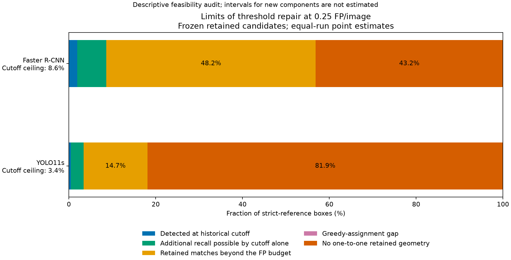

# Research direction: limits of threshold repair under external shift

6 November 2026. **Exploratory feasibility analysis and proposed research focus.**
The user has no access to radiologists. This direction therefore uses frozen
predictions and existing reference annotations without clinical relabeling.
It does not replace the current manuscript or declare a new method validated.

## Recommendation and question

Proposed working title: **When Can a Confidence Threshold Repair External
Detection Failure? A Study of Recall Limits in Chest Radiographs.**

The question is: **For a specified false-positive budget, which part of poor
external recall can a global score cutoff recover, and which part lies beyond
what that operation can change?** The two detectors become contrasting case
studies for this question. The practical output is a diagnostic of which class
of remedy could matter: moving the cutoff, changing candidate ranking/selection,
or recovering usable geometry. It is not a recommendation to deploy any remedy.

This is a stronger focus than simply restating that both detectors generalize
poorly. It connects a proposed remedy to a measurable limit. Its potential
contribution is the empirical audit and its validation under declared controls;
the score-order invariance argument and recall bookkeeping are not new theorems.
Publication-level originality remains unestablished.

## A concrete feasibility result from existing evidence

The new CPU script joins public per-run tables by detector and seed. The
geometry source includes **all 84 strict-positive external images / 95 boxes**,
so its positive-box denominator is the full external positive population.
FROC and historical operating metrics come from **all 3,000 external images**.
The 84 sampled diagnostic negatives are not used to estimate the FROC frontier.
All five runs per detector and all five original FP/image budgets are retained.
The limits condition on the original collection floor 0.00001, cap 100,
native NMS and matching IoU 0.50; they are not limits on unseen candidates.

At the already studied budget of **0.25 FP/image**, the equal-run means are:

| Quantity, % of strict-reference boxes | Faster R-CNN | YOLO11s |
|---|---:|---:|
| Detected at the historical cutoff | 1.895 | 0.421 |
| Best recall over retained-score cutoffs within budget | 8.632 | 3.368 |
| Additional recall possible by changing only the cutoff | 6.737 | 2.947 |
| Matches available only beyond this FP budget under the current order | 48.211 | 14.737 |
| Gap between greedy matching and maximum one-to-one geometry | 0.000 | 0.000 |
| No available one-to-one geometry at IoU 0.50 | 43.158 | 81.895 |

The source's existing marginal 95% intervals for the cutoff ceilings are
**3.703%-15.385%** and **0.889%-7.126%**, respectively. These are copied from the
verified 2,000-draw observation/run analysis, not newly estimated intervals.
They condition on the trained runs and use released images as the external
resampling unit; unknown repeated patients could make them too narrow.
The other new components have **descriptive point estimates only**. Do not
subtract source confidence limits to invent intervals for those components.
Neither detector has a floor-limited run at this particular budget. The complete
budget table preserves the upper-budget support flags instead of hiding them.

The interesting contrast is that Faster R-CNN retains considerable compatible
geometry that a global cutoff cannot recover within this FP budget, whereas
YOLO11s has a larger missing-geometry component in its saved outputs. The latter
is conditional on collection: the previous lower-floor intervention recovered
additional YOLO geometry. It cannot be called an inability of the network to
form proposals. Ranking, FP burden, source annotation definitions and retained
support can all contribute to the observed pattern.



Numerical sources: [per-run audit](../results/threshold_repairability_v1/per_run.csv),
[aggregate audit](../results/threshold_repairability_v1/aggregate.csv),
[source bindings](../results/threshold_repairability_v1/summary.json).
These are a separate feasibility package, not additions to the current
112-artifact manuscript inventory or its numerical claim set.

## Exact scope of the score-cutoff limit

Fix a trained checkpoint, dataset, target definition, retained boxes, native
postprocessing, score ordering/ties and the score-ordered greedy evaluator.
For FP/image budget `b`, define:

```
R0   = recall at the frozen historical cutoff
Rb   = max recall over all retained-score cutoffs with FP/image <= b
Rall = recall when all retained candidates are admitted
G    = maximum one-to-one geometric coverage at the same match IoU
```

If the historical policy satisfies the budget, then
`0 <= R0 <= Rb <= Rall <= G <= 1`, and the following aggregate identity holds:

```
1 = R0 + (Rb - R0) + (Rall - Rb) + (G - Rall) + (1 - G)
```

The terms are detected recall, cutoff headroom, the FP-budget barrier under the
current ordering, an assignment gap and unavailable geometric coverage. This
is a telescoping identity of aggregate recalls, not a causal decomposition of
the cross-dataset performance drop or a new classification of clinical errors.
The code rejects infeasible historical policies rather than silently giving
their headroom a misleading nonnegative interpretation.

A strictly increasing global transformation of a checkpoint's scores preserves
every ordering and tied-score group. Thresholding the transformed scores can
therefore only reproduce the same retained prediction prefixes. It cannot
exceed `Rb` at budget `b`. This conclusion allows an optimistically chosen
cutoff for each run, using test labels to describe the frontier; it does not
validate an externally selected operating policy. The reported quantity is
the mean of per-run maxima, not performance of one shared cutoff or an ensemble.

The statement does not cover feature-dependent or image-dependent rescoring,
changed tie handling, NMS, boxes, caps, collection floors or ontology. Such
changes can change ranking, matching or candidate availability. In particular,
it would be false to claim that *all calibration methods* are unable to help.
`G` is an annotation-informed ceiling, not achieved recall or an implementable
label-free strategy. The budget is a research setting, not a clinically approved
false-alarm tolerance, and these are strict-reference boxes, not diagnosed patients.

## Closest literature and the novelty boundary

Targeted primary-source search checked on 6 November 2026. This is a scoping
search, not an exhaustive systematic review or proof that no similar study
exists. A missing exact phrase in search results does not establish novelty.

| Primary work | What is already established | Implication for this proposal |
|---|---|---|
| [Bolya et al., TIDE, ECCV 2020](https://www.ecva.net/papers/eccv_2020/papers_ECCV/papers/123480562.pdf) | Prediction-file error diagnosis and oracle corrections separating contributions to AP. | General error decomposition and oracle analysis cannot be claimed as new. The proposed focus is a specified FP budget and the limits of a particular allowed repair. |
| [Oksuz et al., LRP](https://arxiv.org/abs/2011.10772) | A detection metric decomposing localization, precision and recall errors, with threshold-dependent analysis. | A threshold-aware metric or simple additive accounting alone is not an original contribution. We do not propose a replacement leaderboard metric. |
| [Kuzucu et al., ECCV 2024](https://arxiv.org/abs/2405.20459) | Joint accuracy/calibration evaluation and detector-specific post-hoc calibration baselines. | Calibration evaluation and inexpensive post-hoc score mapping are existing work; our claim must restrict the allowed transformation and fixed prediction population. |
| [Riedlinger et al., IJCV 2025, LMD](https://link.springer.com/article/10.1007/s11263-025-02377-8) | Lightweight postprocessing can change TP/FP separation and improve detection through quality estimation. | Rescoring that changes ranking is outside the cutoff limit. The study must distinguish this class of repair from a global monotone score map. |
| [Zlotnikov et al., ContextShift, June 2026 preprint](https://arxiv.org/abs/2606.09495) | Controlled context manipulations investigate suppression and reduced valid candidates. | Candidate disappearance versus confidence suppression is not an untouched topic. Our observational datasets do not identify context as the cause; a narrower repair-limit study is defensible. |

Thus the case for publication would rest on a useful, carefully validated
combination: a finite-output repair audit, a comparison across internal/external
cohorts, patient/run uncertainty and real retention controls. Merely renaming
the present analysis or adding its algebra to the manuscript would not establish
substantial methodological novelty.

## Work completed here and what would strengthen the paper

Completed: hash-bound recombination of public results, all run/budget rows,
source-interval reconciliation, an aggregate figure and synthetic software tests
for monotone-score invariance, a ranking repair, missing geometry and a case
where greedy assignment differs from maximum geometric matching. No model was
trained or run, no calibrator was fitted, no threshold was exported and no
reference label was changed. These few synthetic tests validate implementation
assumptions; they are not a completed perturbation benchmark.

The next evidence-building step should remain CPU-only and separately versioned:

1. Extend the audit to the saved internal cohort and reproduce all baseline
   endpoints before comparing components. Use the same checkpoints across
   domains, without claiming identical annotation tasks.
2. Estimate component uncertainty jointly from the same observation/run draws.
   Preserve internal patient clusters, disclose unknown external linkage, and
   keep detector-run draws independent. Use `1 - Rb = (Rall - Rb) + (G - Rall)
   + (1 - G)` as the main accounting identity: unlike historical headroom, it
   remains valid if a resampled historical policy exceeds the budget. Report
   historical-policy feasibility separately; do not discard unfavorable draws.
3. Freeze a systematic synthetic perturbation design before execution: strictly
   monotone score changes, controlled ranking corruption and compatible-box
   removal. Check expected invariances and distinguishable patterns over all
   retained runs. These identify effects of imposed output changes, not causes
   of real acquisition or population shift.
4. Compare what the audit adds beyond the existing exact FROC curve and TIDE/LRP
   concepts. Retain null and contrary cases, all original budgets and candidate
   support flags. Do not make expanded-support whole-cohort claims from the
   enriched diagnostic sample.

**Go/no-go criterion:** proceed with this as the main focus only if the extended
audit gives stable, actionable distinctions that the existing curve/error
summaries do not communicate adequately. If it only repackages those summaries,
keep it as a useful secondary analysis and retain the empirical paper framing.
The current result does not justify changing the prior recommendation against
full-cohort expanded inference. It also does not justify a new detector or
automatic clinical labels as a shortcut to novelty.

## Short pitch for the professor

پیشنهاد من این است که محور کار را به «حدود امکان اصلاح شکست مدل در دیتاست
خارجی» متمرکز کنیم. پرسش این است که با ثابت نگه‌داشتن مدل و خروجی‌های ذخیره‌شده،
تغییر آستانهٔ اطمینان تا چه حد می‌تواند حساسیت را افزایش دهد، وقتی تعداد
مثبت‌های کاذب محدود است. سپس بررسی می‌کنیم چه مقدار از ضعف عملکرد به ترتیب
امتیازها و محدودیت مثبت کاذب مربوط است و چه مقدار با نبود کادر قابل‌تطبیق در
خروجی‌های موجود همراه است.

محاسبهٔ مقدماتی نشان می‌دهد که در بودجهٔ ۰٫۲۵ مثبت کاذب به‌ازای هر تصویر، حتی
بهترین آستانه روی خروجی‌های موجود، میانگین حساسیت را فقط به حدود ۸٫۶ درصد برای
Faster R-CNN و ۳٫۴ درصد برای YOLO11s می‌رساند. این حد توصیفی روی دادهٔ آزمون
محاسبه شده و آستانهٔ پیشنهادی برای استفادهٔ بالینی نیست. مسیر پیشنهادی بدون
نیاز به برچسب‌گذاری پزشکی جدید قابل بررسی است، اما برای ادعای سهم علمی قوی‌تر
باید تحلیل عدم‌قطعیت مشترک، مقایسهٔ داخلی/خارجی و آزمایش‌های کنترل‌شدهٔ خروجی
تکمیل شوند. نوآوری را در این مرحله قطعی نمی‌دانیم؛ هدف، سنجش شفاف و قابل‌آزمون
امکان و محدودیت اصلاح عملکرد است.
