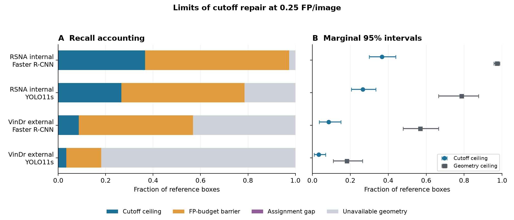
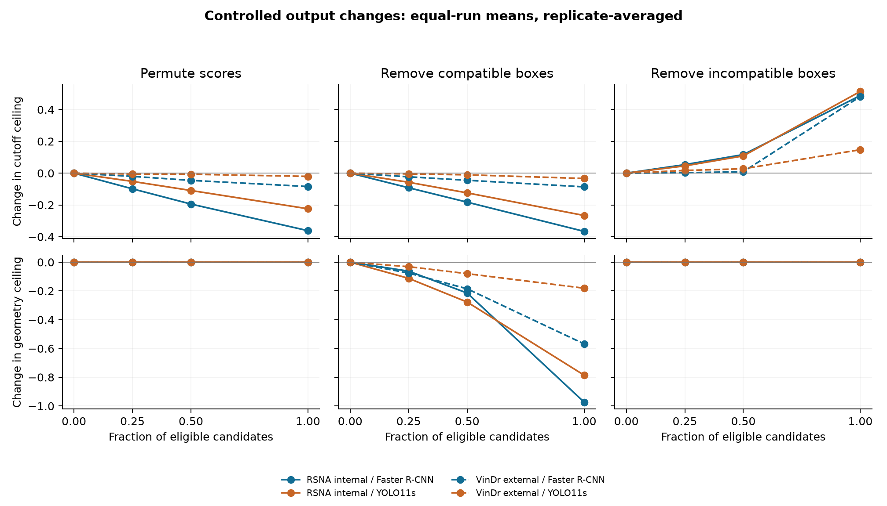

# Threshold repairability v2: complete computational results

Exploratory analysis of original retained candidates. No new inference, training, threshold fitting or clinical relabeling.

All 5 checkpoints per detector, both complete cohorts (750 internal / 3000 external images), 323 known internal patient groups and 2,000 joint draws. All 580 controlled interventions passed their specified invariants.

[Protocol](THRESHOLD_REPAIRABILITY_PROTOCOL_V2.md) | [Exact provenance](../results/threshold_repairability_v2/summary.json) | [Reproduction commands](../README.md#threshold-repairability-v2)

## Components at 0.25 FP/image

1 = cutoff ceiling + FP-budget barrier + assignment gap + unavailable geometry. Components describe fixed-output limits, not causal fractions of external loss. Intervals are marginal percentile intervals; their separate endpoints need not sum to one.

| Cohort / detector | Component | Mean [95% CI] | Valid / undefined |
|---|---|---:|---:|
| RSNA internal / Faster R-CNN | threshold_ceiling | 0.366418 [0.299215, 0.438743] | 2000 / 0 |
| RSNA internal / Faster R-CNN | budget_barrier | 0.606716 [0.530284, 0.679224] | 2000 / 0 |
| RSNA internal / Faster R-CNN | assignment_gap | 0.000000 [0.000000, 0.000000] | 2000 / 0 |
| RSNA internal / Faster R-CNN | unavailable_geometry | 0.026866 [0.012142, 0.043855] | 2000 / 0 |
| RSNA internal / Faster R-CNN | all_candidate_recall | 0.973134 [0.956145, 0.987858] | 2000 / 0 |
| RSNA internal / Faster R-CNN | geometry_ceiling | 0.973134 [0.956145, 0.987858] | 2000 / 0 |
| RSNA internal / Faster R-CNN | historical_recall | 0.350746 [0.263106, 0.431618] | 2000 / 0 |
| RSNA internal / Faster R-CNN | signed_cutoff_difference | 0.015672 [-0.045838, 0.084875] | 2000 / 0 |
| RSNA internal / Faster R-CNN | historical_fp_per_image | 0.232000 [0.147150, 0.329664] | 2000 / 0 |
| RSNA internal / Faster R-CNN | historical_feasible_fraction | 0.600000 [0.200000, 1.000000] | 2000 / 0 |
| RSNA internal / Faster R-CNN | floor_limited_fraction | 0.000000 [0.000000, 0.000000] | 2000 / 0 |
| RSNA internal / Faster R-CNN | cap_saturation_fraction | 0.752533 [0.418058, 0.999721] | 2000 / 0 |
| RSNA internal / YOLO11s | threshold_ceiling | 0.266418 [0.205882, 0.334848] | 2000 / 0 |
| RSNA internal / YOLO11s | budget_barrier | 0.519403 [0.379508, 0.628462] | 2000 / 0 |
| RSNA internal / YOLO11s | assignment_gap | 0.000000 [0.000000, 0.000000] | 2000 / 0 |
| RSNA internal / YOLO11s | unavailable_geometry | 0.214179 [0.123532, 0.335416] | 2000 / 0 |
| RSNA internal / YOLO11s | all_candidate_recall | 0.785821 [0.664584, 0.876468] | 2000 / 0 |
| RSNA internal / YOLO11s | geometry_ceiling | 0.785821 [0.664584, 0.876468] | 2000 / 0 |
| RSNA internal / YOLO11s | historical_recall | 0.194776 [0.087876, 0.293445] | 2000 / 0 |
| RSNA internal / YOLO11s | signed_cutoff_difference | 0.071642 [-0.002291, 0.173569] | 2000 / 0 |
| RSNA internal / YOLO11s | historical_fp_per_image | 0.151733 [0.067772, 0.238898] | 2000 / 0 |
| RSNA internal / YOLO11s | historical_feasible_fraction | 1.000000 [0.400000, 1.000000] | 2000 / 0 |
| RSNA internal / YOLO11s | floor_limited_fraction | 0.000000 [0.000000, 0.000000] | 2000 / 0 |
| RSNA internal / YOLO11s | cap_saturation_fraction | 0.000000 [0.000000, 0.000000] | 2000 / 0 |
| VinDr external / Faster R-CNN | threshold_ceiling | 0.086316 [0.035951, 0.150498] | 2000 / 0 |
| VinDr external / Faster R-CNN | budget_barrier | 0.482105 [0.395060, 0.573823] | 2000 / 0 |
| VinDr external / Faster R-CNN | assignment_gap | 0.000000 [0.000000, 0.000000] | 2000 / 0 |
| VinDr external / Faster R-CNN | unavailable_geometry | 0.431579 [0.335414, 0.521378] | 2000 / 0 |
| VinDr external / Faster R-CNN | all_candidate_recall | 0.568421 [0.478622, 0.664586] | 2000 / 0 |
| VinDr external / Faster R-CNN | geometry_ceiling | 0.568421 [0.478622, 0.664586] | 2000 / 0 |
| VinDr external / Faster R-CNN | historical_recall | 0.018947 [0.000000, 0.048218] | 2000 / 0 |
| VinDr external / Faster R-CNN | signed_cutoff_difference | 0.067368 [0.026663, 0.125646] | 2000 / 0 |
| VinDr external / Faster R-CNN | historical_fp_per_image | 0.047667 [0.028528, 0.066467] | 2000 / 0 |
| VinDr external / Faster R-CNN | historical_feasible_fraction | 1.000000 [1.000000, 1.000000] | 2000 / 0 |
| VinDr external / Faster R-CNN | floor_limited_fraction | 0.000000 [0.000000, 0.000000] | 2000 / 0 |
| VinDr external / Faster R-CNN | cap_saturation_fraction | 0.789600 [0.420198, 1.000000] | 2000 / 0 |
| VinDr external / YOLO11s | threshold_ceiling | 0.033684 [0.009164, 0.070007] | 2000 / 0 |
| VinDr external / YOLO11s | budget_barrier | 0.147368 [0.082918, 0.221432] | 2000 / 0 |
| VinDr external / YOLO11s | assignment_gap | 0.000000 [0.000000, 0.000000] | 2000 / 0 |
| VinDr external / YOLO11s | unavailable_geometry | 0.818947 [0.735997, 0.889809] | 2000 / 0 |
| VinDr external / YOLO11s | all_candidate_recall | 0.181053 [0.110191, 0.264003] | 2000 / 0 |
| VinDr external / YOLO11s | geometry_ceiling | 0.181053 [0.110191, 0.264003] | 2000 / 0 |
| VinDr external / YOLO11s | historical_recall | 0.004211 [0.000000, 0.016005] | 2000 / 0 |
| VinDr external / YOLO11s | signed_cutoff_difference | 0.029474 [0.008079, 0.059579] | 2000 / 0 |
| VinDr external / YOLO11s | historical_fp_per_image | 0.027067 [0.012130, 0.040667] | 2000 / 0 |
| VinDr external / YOLO11s | historical_feasible_fraction | 1.000000 [1.000000, 1.000000] | 2000 / 0 |
| VinDr external / YOLO11s | floor_limited_fraction | 0.000000 [0.000000, 0.000000] | 2000 / 0 |
| VinDr external / YOLO11s | cap_saturation_fraction | 0.000000 [0.000000, 0.000000] | 2000 / 0 |

Historical feasibility is a fraction of selected runs; a negative signed cutoff difference is retained when the historical policy exceeds the budget. The cutoff ceiling averages per-run optimistic envelopes, not one common cutoff or an exported policy.

## Coupled contrasts

Internal patient clusters and external images are sampled independently. Each cohort's observations are shared across detectors and runs. Run multiplicities are independent between detectors and reused for the same checkpoints across cohorts. Every nonlinear endpoint is recomputed within each draw. Unknown external patient dependence remains a limitation.

| Contrast | Component | Change [95% CI] | Valid / undefined |
|---|---|---:|---:|
| internal:faster_rcnn-yolo11s | threshold_ceiling | 0.100000 [0.050874, 0.148723] | 2000 / 0 |
| internal:faster_rcnn-yolo11s | budget_barrier | 0.087313 [-0.026232, 0.230313] | 2000 / 0 |
| internal:faster_rcnn-yolo11s | assignment_gap | 0.000000 [0.000000, 0.000000] | 2000 / 0 |
| internal:faster_rcnn-yolo11s | unavailable_geometry | -0.187313 [-0.312398, -0.097908] | 2000 / 0 |
| internal:faster_rcnn-yolo11s | all_candidate_recall | 0.187313 [0.097908, 0.312398] | 2000 / 0 |
| internal:faster_rcnn-yolo11s | geometry_ceiling | 0.187313 [0.097908, 0.312398] | 2000 / 0 |
| external:faster_rcnn-yolo11s | threshold_ceiling | 0.052632 [0.005982, 0.110876] | 2000 / 0 |
| external:faster_rcnn-yolo11s | budget_barrier | 0.334737 [0.226148, 0.439571] | 2000 / 0 |
| external:faster_rcnn-yolo11s | assignment_gap | 0.000000 [0.000000, 0.000000] | 2000 / 0 |
| external:faster_rcnn-yolo11s | unavailable_geometry | -0.387368 [-0.484415, -0.293936] | 2000 / 0 |
| external:faster_rcnn-yolo11s | all_candidate_recall | 0.387368 [0.293936, 0.484415] | 2000 / 0 |
| external:faster_rcnn-yolo11s | geometry_ceiling | 0.387368 [0.293936, 0.484415] | 2000 / 0 |
| external-internal:faster_rcnn | threshold_ceiling | -0.280102 [-0.363955, -0.187913] | 2000 / 0 |
| external-internal:faster_rcnn | budget_barrier | -0.124611 [-0.239165, -0.008183] | 2000 / 0 |
| external-internal:faster_rcnn | assignment_gap | 0.000000 [0.000000, 0.000000] | 2000 / 0 |
| external-internal:faster_rcnn | unavailable_geometry | 0.404713 [0.305426, 0.494324] | 2000 / 0 |
| external-internal:faster_rcnn | all_candidate_recall | -0.404713 [-0.494324, -0.305426] | 2000 / 0 |
| external-internal:faster_rcnn | geometry_ceiling | -0.404713 [-0.494324, -0.305426] | 2000 / 0 |
| external-internal:yolo11s | threshold_ceiling | -0.232734 [-0.304000, -0.164443] | 2000 / 0 |
| external-internal:yolo11s | budget_barrier | -0.372035 [-0.465369, -0.268596] | 2000 / 0 |
| external-internal:yolo11s | assignment_gap | 0.000000 [0.000000, 0.000000] | 2000 / 0 |
| external-internal:yolo11s | unavailable_geometry | 0.604768 [0.502586, 0.693854] | 2000 / 0 |
| external-internal:yolo11s | all_candidate_recall | -0.604768 [-0.693854, -0.502586] | 2000 / 0 |
| external-internal:yolo11s | geometry_ceiling | -0.604768 [-0.693854, -0.502586] | 2000 / 0 |
| difference_of_domain_changes | threshold_ceiling | -0.047368 [-0.109369, 0.024273] | 2000 / 0 |
| difference_of_domain_changes | budget_barrier | 0.247423 [0.113568, 0.371896] | 2000 / 0 |
| difference_of_domain_changes | assignment_gap | 0.000000 [0.000000, 0.000000] | 2000 / 0 |
| difference_of_domain_changes | unavailable_geometry | -0.200055 [-0.314487, -0.083633] | 2000 / 0 |
| difference_of_domain_changes | all_candidate_recall | 0.200055 [0.083633, 0.314487] | 2000 / 0 |
| difference_of_domain_changes | geometry_ceiling | 0.200055 [0.083633, 0.314487] | 2000 / 0 |

## Controlled output changes

These interventions modify copies of saved outputs and use reference labels only for diagnostic controls. They do not estimate performance of an implementable repair. Three imposed replicates are averaged within each checkpoint before equal-run averaging; they are not extra training runs or patients. Score powers preserve the entire exact frontier; score permutations preserve geometry but can improve or worsen ranked recall. Removing all compatible candidates eliminates geometric coverage. Removing incompatible candidates cannot worsen the frontier. All effects, including null and adverse ones, are retained.

| Cohort / detector | Family | Level | Cutoff-ceiling change | Geometry-ceiling change | Historical-recall change |
|---|---|---:|---:|---:|---:|
| internal / Faster R-CNN | power | 0.5 | +0.000000 | +0.000000 | +0.144776 |
| internal / Faster R-CNN | power | 2 | +0.000000 | +0.000000 | -0.157463 |
| internal / Faster R-CNN | permute_scores | 0.25 | -0.098756 | +0.000000 | -0.080597 |
| internal / Faster R-CNN | permute_scores | 0.5 | -0.194527 | +0.000000 | -0.169403 |
| internal / Faster R-CNN | permute_scores | 1 | -0.361940 | +0.000000 | -0.342786 |
| internal / Faster R-CNN | remove_compatible | 0.25 | -0.092040 | -0.062687 | -0.087811 |
| internal / Faster R-CNN | remove_compatible | 0.5 | -0.182587 | -0.214677 | -0.173881 |
| internal / Faster R-CNN | remove_compatible | 1 | -0.366418 | -0.973134 | -0.350746 |
| internal / Faster R-CNN | remove_incompatible | 0.25 | +0.053483 | +0.000000 | +0.000000 |
| internal / Faster R-CNN | remove_incompatible | 0.5 | +0.116667 | +0.000000 | +0.000000 |
| internal / Faster R-CNN | remove_incompatible | 1 | +0.488060 | +0.000000 | +0.000000 |
| internal / YOLO11s | power | 0.5 | +0.000000 | +0.000000 | +0.208209 |
| internal / YOLO11s | power | 2 | +0.000000 | +0.000000 | -0.088060 |
| internal / YOLO11s | permute_scores | 0.25 | -0.051990 | +0.000000 | -0.033085 |
| internal / YOLO11s | permute_scores | 0.5 | -0.109204 | +0.000000 | -0.070398 |
| internal / YOLO11s | permute_scores | 1 | -0.224129 | +0.000000 | -0.156716 |
| internal / YOLO11s | remove_compatible | 0.25 | -0.057463 | -0.112687 | -0.044030 |
| internal / YOLO11s | remove_compatible | 0.5 | -0.124129 | -0.277363 | -0.094279 |
| internal / YOLO11s | remove_compatible | 1 | -0.266418 | -0.785821 | -0.194776 |
| internal / YOLO11s | remove_incompatible | 0.25 | +0.045522 | +0.000000 | +0.000000 |
| internal / YOLO11s | remove_incompatible | 0.5 | +0.108458 | +0.000000 | +0.000000 |
| internal / YOLO11s | remove_incompatible | 1 | +0.514179 | +0.000000 | +0.000000 |
| external / Faster R-CNN | power | 0.5 | +0.000000 | +0.000000 | +0.027368 |
| external / Faster R-CNN | power | 2 | +0.000000 | +0.000000 | -0.014737 |
| external / Faster R-CNN | permute_scores | 0.25 | -0.020351 | +0.000000 | -0.005614 |
| external / Faster R-CNN | permute_scores | 0.5 | -0.045614 | +0.000000 | -0.010526 |
| external / Faster R-CNN | permute_scores | 1 | -0.084211 | +0.000000 | -0.018947 |
| external / Faster R-CNN | remove_compatible | 0.25 | -0.023158 | -0.075789 | -0.004912 |
| external / Faster R-CNN | remove_compatible | 0.5 | -0.044912 | -0.185263 | -0.013333 |
| external / Faster R-CNN | remove_compatible | 1 | -0.086316 | -0.568421 | -0.018947 |
| external / Faster R-CNN | remove_incompatible | 0.25 | +0.002105 | +0.000000 | +0.000000 |
| external / Faster R-CNN | remove_incompatible | 0.5 | +0.009123 | +0.000000 | +0.000000 |
| external / Faster R-CNN | remove_incompatible | 1 | +0.482105 | +0.000000 | +0.000000 |
| external / YOLO11s | power | 0.5 | +0.000000 | +0.000000 | +0.014737 |
| external / YOLO11s | power | 2 | +0.000000 | +0.000000 | -0.004211 |
| external / YOLO11s | permute_scores | 0.25 | -0.005614 | +0.000000 | +0.000000 |
| external / YOLO11s | permute_scores | 0.5 | -0.007018 | +0.000000 | -0.001404 |
| external / YOLO11s | permute_scores | 1 | -0.020351 | +0.000000 | -0.002105 |
| external / YOLO11s | remove_compatible | 0.25 | -0.004912 | -0.031579 | -0.001404 |
| external / YOLO11s | remove_compatible | 0.5 | -0.010526 | -0.080000 | -0.001404 |
| external / YOLO11s | remove_compatible | 1 | -0.033684 | -0.181053 | -0.004211 |
| external / YOLO11s | remove_incompatible | 0.25 | +0.016842 | +0.000000 | +0.000000 |
| external / YOLO11s | remove_incompatible | 0.5 | +0.027368 | +0.000000 | +0.000000 |
| external / YOLO11s | remove_incompatible | 1 | +0.147368 | +0.000000 | +0.000000 |

## Scope and audit trail

Exact FROC already supplies the cutoff ceiling and all-candidate recall. This analysis adds their interpretation alongside maximum geometric matching, coupled uncertainty and controlled verification; it does not propose a new ranking metric, prove a new theorem, or claim superiority over TIDE/LRP. Strictly increasing global score maps preserve prefixes when membership/ties/postprocessing remain fixed. Feature-dependent reranking, changed geometry, NMS, ontology, score floor or cap lie outside that bound. Original internal FP32 versus external AMP provenance remains unchanged.

All baseline FROC, support and historical count checks passed; external maximum matching agrees with the prior census-positive diagnostic. Source/protocol hashes were checked before and after computation. The original scientific records and the separate v1 pilot remain unchanged.

Complete machine-readable outputs retain all original budgets:

- [Per-run components](../results/threshold_repairability_v2/per_run.csv)
- [Marginal component intervals](../results/threshold_repairability_v2/intervals.csv)
- [Joint contrasts](../results/threshold_repairability_v2/contrasts.csv)
- [Every imposed intervention](../results/threshold_repairability_v2/perturbations.csv)
- [Replicate-averaged controls](../results/threshold_repairability_v2/perturbation_summary.csv)

Private joint arrays enable exact replay without publishing images, image identifiers, prediction arrays or restricted annotations. Confidence intervals condition on the available training sample, five checkpoints and references. Clinical equivalence and causal attribution remain unestablished.
